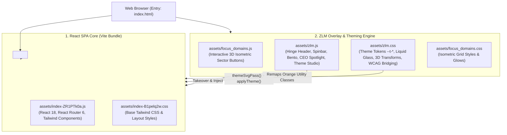

# IICE IISER Bhopal (zlm_final) — AI Developer & Model Guide

> **Target Audience:** Future AI models (and human developers) assigned to maintain, extend, retheme, or modify the **Innovation and Incubation Centre for Entrepreneurship (IICE), IISER Bhopal** official website.
>
> **Core Principle:** This guide eliminates exploratory trial-and-error. Read this document before touching any file. It provides the exact layout, file roles, data locations, function references, dynamic theme architecture, and step-by-step editing playbooks.

---

## Table of Contents
1. [Architecture & System Design](#1-architecture--system-design)
2. [Complete Sitemap & URL Routing Map](#2-complete-sitemap--url-routing-map)
3. [Resource Map (Assets, Media, Fonts & Data Stores)](#3-resource-map)
4. [File & Directory Topology](#4-file--directory-topology)
5. [Code Function Dictionary](#5-code-function-dictionary)
6. [Data Store Schemas & Locations in the Bundle](#6-data-store-schemas--locations)
7. [The Dynamic Theme System Specification](#7-the-dynamic-theme-system-specification)
8. [Where to Edit, What to Edit, How to Edit (Playbooks)](#8-where-to-edit-what-to-edit-how-to-edit)
9. [Critical Invariants, Guardrails & Gotchas](#9-critical-invariants-guardrails--gotchas)
10. [Local Development, Build & Deployment Guide](#10-local-development-build--deployment-guide)

---

## 1. Architecture & System Design

The IICE IISER Bhopal website operates on a **Dual-Engine Architecture**:



### Key Architectural Concepts
1. **React SPA Core (`index-ZR1PTk0a.js`)**:
   - Handles client-side routing via `react-router-dom`.
   - Contains page views, forms, modals, tables, and embedded JSON data arrays.
   - Mounts onto `<div id="root"></div>`.
2. **ZLM Overlay Layer (`zlm.js` + `zlm.css`)**:
   - **Header Takeover:** Hides the React template's default static header (`div.min-h-[82px]`) and injects a sticky, frosted-glass "Hinge Header" with responsive SVG branding and accessible mega-menus.
   - **Homepage Overlays:** Injects the 3D Flip Program Cards (Pre-Incubation, Incubation, Commercialisation), the Stakeholder Gateways Spinbar (scroll-driven 3D ring on desktop, touch deck on mobile), and the "Life at IICE" Photo Bento Grid.
   - **Focus Domains:** `focus_domains.js` injects 9 animated isometric sector buttons under the Focus Domains heading.
   - **Leadership Spotlight:** Injects the verified CEO & Coordinator dual-profile spotlight into `/our-team`.
   - **Dynamic Theming:** Bridges all site colors to 17 CSS Custom Properties (`--t-*`), manages the bottom "Theme Studio" panel, inlines external SVGs, and live-recolors them without page reloads.
3. **Cache-Buster System (`?v=N`)**:
   - In `index.html`, all script and style links carry a `?v=55` query parameter.
   - **Crucial Rule:** Any time you edit `zlm.js`, `zlm.css`, `focus_domains.js`, or the bundle, you **must increment this version number** in `index.html` (e.g. `?v=56`).

---

## 2. Complete Sitemap & URL Routing Map

The SPA uses HTML5 History API routing. The Python server and Vercel route all requests to `index.html`.

| Route Path | Page Title / Domain | Primary Purpose | Key Content & Interactive Elements |
|:---|:---|:---|:---|
| `/` | **Home** | Primary gateway to IICE | Hero with cursor-activated scribble/highlight, Focus Domains isometric buttons, 3D Flip Cards (TRL 1–9), Know Your Journey, Stakeholder Gateways Spinbar, USP Bento Matrix, Life at IICE Bento Grid, 14 Partner Logo Marquee, Video Talks Gallery, Stats Counter, Testimonials, Footer |
| `/who-we-are` | **Who We Are** | Mission, vision, core objectives | High-res campus building showcase, institutional facts, core pillars, ecosystem statistics |
| `/board-of-directors` | **Managing Committee** | Governing body | Grid of governing committee members & directors (`CG` array), profile links, institutional designations |
| `/our-team` | **Team & Committees** | Operational leadership & staff | Injected Dual Leadership Spotlight (Dr. Sandeep Raut CEO + Dr. Bharathwaj Sathyamoorthy), followed by staff divided into Leadership, Domain Heads, Operations (`Xh` array) |
| `/noida-office` | **Bhopal Ecosystem** | Physical presence & campus | High-res aesthetic photo card, co-working facilities, campus infrastructure details |
| `/programs` | **Programs & Grants** | Directory of all funding & incubation programs | Catalog of all 8 flagship programs with status badges, funding amounts, deadline dates, and filter tabs |
| `/programs/:id` | **Program Deep Dive** | Specific grant / program page | Full program breakdown: eligibility, financial support, selection process, contact person, downloadable guidelines, FAQ accordion |
| `/programs/dst-nidhi-eir` | **DST NIDHI-EIR** | Entrepreneur-in-Residence fellowship | Rs 30,000/month fellowship details, eligibility for early-stage innovators |
| `/programs/dst-nidhi-tbi-seed` | **NIDHI-TBI Seed Support** | Milestone-linked seed funding | Rs 10 Lakh to Rs 1 Crore equity/debt funding guidelines |
| `/programs/birac-edge-program` | **BIRAC-EDGE Program** | Biotech & MedTech incubation | Specialized bio-incubation support, faculty mentoring |
| `/programs/student-innovation-grant-sig`| **SIG (3rd Call)** | Student pre-seed grant | Student grants up to Rs 2 Lakh, prototyping support |
| `/programs/iice-innovation-club` | **Innovation Club** | Student & campus ideation | Hackathons, workshops, entrepreneurship development |
| `/partners` | **Support & Partners** | Institutional & corporate network | Interactive catalog of all 14 official partner organizations with category filters |
| `/ipr` | **IPR & Policy** | Intellectual property cell | Patent filing support, IP policy documentation, tech transfer guidance |
| `/lab` | **CIF & Innovation Labs** | Research & prototyping infrastructure| Central Instrumentation Facility (CIF) overview, list of 20+ instruments, step-by-step booking instructions linking to IISERB CIF and I-STEM portals |
| `/office-spaces` | **Incubation Space** | Physical co-working floor | 20,000 sq.ft facility specs, conference rooms, wet/dry labs, desk options |
| `/branding` | **IPR & Marketing Help** | Startup enablement services | Business establishment, brand identity, IP filing, web/design collateral services |
| `/startups` | **Startups Directory** | Incubatee portfolio | Directory of all 14 verified startups with domain badges, descriptions, and verified external website links |
| `/join-as-mentor` | **Join as Mentor** | Mentor onboarding | Expression of Interest (EOI) workflow, faculty/industry mentor criteria |
| `/join-as-investor` | **Join as Investor** | Angel & VC network | Deal flow access, co-investment opportunities, partner network |
| `/careers` | **Careers @ IICE** | Open positions | Internal IICE job openings (`bHW` array) + Incubatee startup hiring board (`qT` array) |
| `/careers/apply` | **Apply for Career** | Job application form | Interactive resume upload and applicant details form |
| `/upcoming-events` | **Conclaves & Events** | Event calendar | Conclaves, bootcamps, workshops, past and upcoming activity cards |
| `/upcoming-events/avinya-2k26`| **Avinya Conclave** | Flagship event portal | Industry-Academia Conclave 2.0 & Startup Exhibition overview, agenda, speakers, gallery |
| `/upcoming-events/:eventId` | **Event Details** | Specific event view | In-depth schedule, speaker lineup, registration links |
| `/latest-news` | **News & Past Events** | Press releases & event recaps | Archive of conclaves, MSME RAMP programs, A-ESDP training, funding milestones |
| `/flash-news` | **Flash News** | Real-time announcements | Broadcast ticker for active calls, deadlines, and notifications |
| `/tenders` | **Tenders & Procurement** | Official procurement notices | Downloadable tender documents (PDFs), closing dates, technical specs |
| `/contact` | **Contact Us** | Direct inquiry channel | Interactive contact form, office address, map link, email chips |
| `/privacy-policy` | **Privacy Policy** | Legal | Privacy terms and data protection policies |
| `/terms-of-use` | **Terms of Use** | Legal | Website usage rules and terms |
| `/disclaimer` | **Disclaimer** | Legal | Institutional disclaimers |
| `*` | **404 Not Found** | Error page | Branded fallback with "Return Home" button |

---

## 3. Resource Map

### 3.1 Photography & Media Asset Catalog (`assets/media/`)
All photographic assets have been standardized to high-efficiency WebP format with semantic prefixes. **Never reuse an image across unrelated entities.**

```
assets/media/
├── people/                     # 20 verified portraits of leadership & faculty
│   ├── sandeep.webp            # Dr. Sandeep Raut (CEO, IICE)
│   ├── bharathwaj.webp         # Dr. Bharathwaj Sathyamoorthy (Coordinator, IICE)
│   ├── rst.webp                # Prof. Raghuvir Singh Tomar (Director In-Charge, IISERB)
│   ├── sanjit.webp             # Prof. Sanjit Konar (Deputy Director, IISERB)
│   ├── abhijit.webp            # Prof. Abhijit Patra (Convener, Executive Committee)
│   ├── chandan.webp            # Prof. Chandan Sahi (Dean R&D & Head CIF)
│   ├── dchopra.webp            # Prof. Deepak Chopra (Coordinator TEC)
│   ├── debasis.webp            # Dr. Debasis Nayak (Coordinator BIRAC-EDGE)
│   ├── jeet.webp               # Dr. Jeet Kalia (Chemistry)
│   ├── kgaurav.webp            # Dr. Kumar Gaurav (EES)
│   ├── gaurav.webp             # Mr. Gaurav Awasthi (Treasurer / Deputy Registrar)
│   ├── gobardhan.webp          # Prof. Gobardhan Das (Director / Advisor)
│   ├── adarsh.webp, aditya.webp, ajit.webp, ramya.webp, rati.webp, rssingh.webp, sangit.webp, sdatta.webp
│
├── cif_*                       # 20 Central Instrumentation Facility instrument photos
│   ├── cif_laser.webp          # Femtosecond Laser System (Used in Flip Card 01)
│   ├── cif_nmr_700.webp        # 700 MHz High-Field NMR (Used in Flip Card 02)
│   ├── cif_fesem.webp          # Field-Emission SEM (Used in Flip Card 03)
│   ├── cif_xrd.webp, cif_afm.webp, cif_maldi.webp, cif_lc_qtof.webp, cif_chbns.webp, cif_epr.webp, cif_bet.webp...
│
├── bento_*                     # 8 Life at IICE bento showcase images
│   ├── bento_conclave_expo.webp, bento_conclave_session.webp, bento_conclave_visit.webp
│   ├── bento_ramp_workshop.webp, bento_ramp_lab.webp, bento_ramp_panel.webp, bento_ramp_tour.webp, bento_ramp_demo.webp
│
├── campus_*                    # 15 IISER Bhopal campus & facility photos
│   ├── campus_academics.webp, campus_gate_evening.webp, campus_institute_day.webp, campus_convo2026.webp...
│
├── event_*                     # 18 event & conclave action photographs
│   ├── event_aesdp_lab.webp, event_big_outreach.webp, event_conclave_audience.webp, event_conclave_exhibition.webp...
│
├── iice_*                      # 10 incubator facility interior photographs
│   ├── iice_meeting_room.webp, iice_cafeteria.webp, iice_business.webp, iice_equipment.webp, iice_ipr.webp...
│
├── yt_*                        # 6 YouTube lecture & talk thumbnail stills
│   ├── yt_VJ-IiVkhbDo.webp, yt_yrVJ7ZRzT1s.webp, yt_8vksSJ4HU7A.webp, yt_43NC3fZ3mQE.webp...
│
└── logo_iice.webp, logo_iiserb.webp  # Official institutional marks
```

### 3.2 Partner Logos (`assets/partners/`)
14 official institutional SVG tiles matching the partner directory:
- `partner-1.svg` — Department of Science & Technology (DST - NSTEDB)
- `partner-2.svg` — IISER Bhopal (Host Institute)
- `partner-3.svg` — BIRAC (Dept. of Biotechnology)
- `partner-4.svg` — Ministry of MSME (RAMP & ESDP)
- `partner-5.svg` — Startup India & DPIIT
- `partner-6.svg` — ANRF Research Development & Innovation Fund
- `partner-7.svg` — MeitY Startup Hub
- `partner-8.svg` — HDFC Bank (Parivartan Startup Banking)
- `partner-9.svg` — Bharat Heavy Electricals Limited (BHEL Bhopal)
- `partner-10.svg` — Lupin Limited (Bhopal)
- `partner-11.svg` — Zydus Lifesciences Group
- `partner-12.svg` — IITM Pravartak Technologies Foundation
- `partner-13.svg` — SINE — IIT Bombay
- `partner-14.svg` — FITT — IIT Delhi

### 3.3 Startup Logos (`assets/startups/`)
14 startup brand tiles formatted at the exact 6:5 card aspect ratio:
- `startup-1.svg` — Plabeltech Pvt Ltd (Real logo, links to `https://plabeltech.com/`)
- `startup-2.svg` — Cytoforge Therapeutics Pvt Ltd (Real logo, links to `https://cytoforgetherapeutics.com/`)
- `startup-3.svg` — Luminojen Pvt Ltd (Links out)
- `startup-4.svg` — SimDaas Autonomy Pvt Ltd (Links out)
- `startup-5.svg` — Xtalsphere Pvt Ltd (Real logo, links out)
- `startup-6.svg` — Richnex Skinscience Laboratory Pvt Ltd (Links out)
- `startup-7.svg` — Powernet Technology Pvt Ltd (Links out)
- `startup-8.svg` — Intisen Technology Pvt Ltd (Real brand tile)
- `startup-9.svg` — Miniguru T-Labs (Real brand tile)
- `startup-10.svg` — Adit Bioscience Pvt Ltd
- `startup-11.svg` — Beyond Limit Devices
- `startup-12.svg` — Konarq Technologies (Real brand tile)
- `startup-13.svg` — Protomate AI Pvt Ltd
- `startup-14.svg` — MBiosys Pvt Ltd

### 3.4 Fonts (`Fonts/`)
The site uses the variable Google Font **Plus Jakarta Sans**, stored locally:
`Fonts/Plus_Jakarta_Sans/PlusJakartaSans-VariableFont_wght.ttf`.
Preloaded and served with immutable 1-year cache headers in `vercel.json`.

---

## 4. File & Directory Topology

```
/
├── index.html                   # HTML entry point: preloads, initial theme loader, script versioning (?v=55)
├── server.py                    # Threaded Python SPA dev server (port 3000, 404 guards on static assets)
├── vercel.json                  # Production SPA rewrites & long-term cache headers
├── package.json                 # Project scripts (start, dev, serve)
├── README.md                    # Changelog and build summary
├── AI_DEVELOPER_GUIDE.md        # THIS GUIDE: Primary AI instruction manual
│
├── assets/                      # Active production code and static assets
│   ├── index-ZR1PTk0a.js        # Main React 18 SPA bundle (all routes, views, and data arrays)
│   ├── index-B1pelq2w.css       # Main Tailwind stylesheet bundle
│   ├── zlm.js                   # Overlay engine (Hinge header, spinbar, bento, theme studio, life-cycles)
│   ├── zlm.css                  # Overlay styling, 8 theme palettes, liquid glass, universal Tailwind remapping
│   ├── focus_domains.js         # Isometric 3D Focus Domains button renderer
│   ├── focus_domains.css        # Focus Domains isometric styles & reactive glowing medallions
│   ├── focus_domains_sectors.json # Sector definitions & animated SVG metadata
│   ├── logo_header.svg          # Crisp vector lockup (IICE + IISERB + Plus Jakarta Sans)
│   ├── media/                   # Media repository (people/, cif_*, bento_*, campus_*, etc.)
│   ├── partners/                # 14 partner logo SVGs
│   └── startups/                # 14 startup brand tiles
│
├── Fonts/                       # Plus Jakarta Sans variable font files
├── Tender/                      # Downloadable tender procurement notice PDFs
├── HomePage/                    # Legacy/source focus domain icon assets
├── KnowYourJourney/             # Journey timeline icons and hover states
├── BoardOfDirectors/            # Fallback SVG avatar cards
├── OurTeam/                     # Fallback SVG avatar cards
├── WhoWeAre/                    # High-res main building imagery & legacy icons
├── Labs/                        # Lab illustration assets
└── OfficeSpace/                 # Office facility SVG assets
```

---

## 5. Code Function Dictionary

### 5.1 `assets/zlm.js` — The Core Overlay Engine
`zlm.js` runs automatically on page load and on SPA route changes.

| Function | Line # | Responsibility & Behavior |
|:---|:---|:---|
| `takeover()` | ~1831 | Checks for the React template's default header (`div.min-h-[82px]`). If found, sets `display: none` and moves `.zlm-header` directly above it in the DOM. |
| `takeoverRetry()` | ~1844 | React renders asynchronously; retries `takeover()` every 60ms for 3.5 seconds to guarantee the header is never stranded at the bottom of `<body>`. |
| `fixStickyAncestors(node)` | ~1852 | Traverses up the DOM tree and replaces `overflow: hidden` with `overflow: clip` on ancestor containers so `position: sticky` continues working reliably. |
| `buildHeader()` | ~516 | Assembles the sticky glass header: desktop menu items, mega-dropdown popovers, vector logo, CTA pill button, and mobile burger button. |
| `buildMobile()` | ~660 | Builds the slide-out mobile drawer with accordion-style submenu disclosure and an independent close button. |
| `buildThemeStudio()` | ~307 | Injects the `#zlm-theme-studio` panel right before the dark footer. Renders all 8 theme swatch cards, prev/next arrows, shuffle, and reset controls. |
| `buildThemeFAB()` | ~375 | Injects the fixed, floating theme palette button at the bottom-left of the viewport. Clicking it opens and centers the Theme Studio. |
| `applyTheme(id)` | ~213 | Applies theme `id`: sets `html[data-zlm-theme]`, updates `localStorage("zlm-theme")`, adds `.zlm-theming` for 700ms smooth cross-fading, and triggers `themeSvgPass()` & `inlineThemedImages()`. |
| `cycleTheme(dir)` | ~229 | Advances to the next (`+1`) or previous (`-1`) theme in circular order. |
| `themeSvgPass()` | ~264 | Scans all `<svg>` and child nodes; remaps hardcoded hex colors (`#6c3231`, `#ff8a40`, etc.) to active CSS variables via `SVG_ATTR_MAP`. |
| `inlineThemedImages()` | ~283 | Detects `` tags loading SVG files from specified folders (e.g. `KnowYourJourney`), fetches their raw XML, replaces the `` with inline `<svg data-theme-svg="1">`, and recolors them with `themeSvgPass()`. |
| `buildFlagship()` | ~720 | Injects DERBI spec §2 3D Flip Program Cards ("01 Catalyse", "02 Culture", "03 Commercialise") before the journey section on the homepage (`/`). |
| `buildGateways()` | ~1130| Injects the Stakeholder Gateways Spinbar section before the partners marquee on `/`. Computes 3D transform geometry for desktop card ring and mobile deck. |
| `spinEngine(...)` | ~917 | High-performance, passive scroll-scrubbed physics engine: translates page scroll distance into card angle/offset with under-damped spring physics. |
| `buildBento()` | ~1655| Injects the 8-cell "Life at IICE" bento grid on `/` with directional mouse-entry hover wipe overlays (`dirFromEvent`). |
| `buildCeoSpotlight()` | ~1402| Injects the dual leadership profile card into `/our-team` for Dr. Sandeep Raut and Dr. Bharathwaj Sathyamoorthy. |
| `applyTints()` | ~1449| Analyzes `<main>` bands and sections, enforcing a strict deterministic alternating warm wash (`.zlm-tone--a` and `.zlm-tone--b`). |
| `glassify()` | ~1529| Scans cards, stat strips, and forms across the page and adds `.zlm-glass` tinted liquid glass material with specular edges and hover sheens. |
| `revealPass()` | ~1609| Uses `IntersectionObserver` to trigger one-shot entrance animations (`.zlm-revealed`) on overlay blocks as they scroll into view. |
| `pageTransition` | ~431 | Coordinates SPA route transitions: sweeps `.zlm-veil` across the viewport, executes route swap, and performs staggered cascade entrance (`.zlm-route-enter`). |
| `navigate(href)` | ~475 | SPA navigation helper: pushes new URL to `history`, triggers `popstate` for React Router, and coordinates `pageTransition`. |
| `bootWatchdog()` | ~1755| Monitors page load; once React has mounted, smoothly fades out and dismisses the branded boot preloader screen. |
| `crashWatchdog()` | ~1814| Safety guard: checks if `#root` unmounted due to a React error. If detected, triggers an automatic one-time session reload and logs the error to `localStorage["zlm-last-error"]`. |
| `refresh()` | ~1876| Master orchestrator called on every URL change: runs `takeover()`, mounts/unmounts homepage overlay sections, and schedules tinting/glass passes. |

### 5.2 `assets/focus_domains.js` — Isometric Sector Buttons
- **`renderFocusDomains(container)`**: Builds a 3x3 responsive grid featuring pure animated 3D isometric buttons for 9 sectors (AgriTech, AI/ML, CleanTech, Cyber/FinTech, Defence, Energy Storage, IoT, MedBioTech, Quantum).
- **`mountFocusDomains()`**: Finds the "Focus Domains" `<h2>` heading on `/`, hides the old static React grid (`.zlm-old-grid-hidden`), and inserts the new animated container directly below the heading.
- **`mountInterval`**: Retries mounting every 100ms for up to 60 attempts until React finishes rendering the homepage.

### 5.3 `server.py` — Local Development Server
- **`SPAHandler`**: Custom Python `http.server` handler.
  - Correct MIME types for `.webp`, `.avif`, `.woff2`, `.mjs`, `.svg`.
  - Sends `Cache-Control: no-cache` for HTML and SPA routes so updates appear immediately.
  - Sends `Cache-Control: public, max-age=3600` for static assets.
  - **404 Safety Guard**: Returns strict 404 for missing static extensions (never falls back to `index.html` for missing `.webp` or `.svg` files, surfacing asset bugs immediately).
  - Routes all non-asset requests to `/index.html`.

---

## 6. Data Store Schemas & Locations in the Bundle

The core data of the website is compiled into `assets/index-ZR1PTk0a.js`. Below are the exact variable identifiers, byte offsets, and JSON schemas.

### 6.1 Programs & Grants (`rd` array, ~byte 390,000)
```typescript
interface Program {
  id: string;               // e.g. "dst-nidhi-eir-2026"
  slug: string;             // e.g. "dst-nidhi-eir" -> maps to /programs/:slug
  name: string;             // e.g. "DST NIDHI EIR"
  title: string;            // e.g. "DST NIDHI Entrepreneur-in-Residence (EIR)"
  fullTitle: string;        // Official Government / Institutional full name
  cardImage: string;        // Path to CIF instrumentation or lab photo (/assets/media/...)
  bannerImage: string;      // Banner image path
  startDate: string;        // "DD/MM/YYYY"
  postDate: string;         // "DD/MM/YYYY"
  deadline: string;         // "DD/MM/YYYY" or "Rolling"
  applyLink: string;        // Target route or external Google Form / portal URL
  externalLink: string;     // Outbound portal URL
  logos: string[];          // Array of sponsor/partner logo paths
  contact: {
    name: string;           // Responsible coordinator or CEO
    email: string;          // Direct contact email
    phone: string;          // Direct phone number
    location: string;       // Office room / floor
  };
  type: "Active" | "Upcoming" | "Rolling";
  isNew: boolean;
  tags: string[];           // Domain tags e.g. ["NIDHI-TBI", "DeepTech", "Bioengineering"]
  domain: string;           // Primary sector
  process: { step: string }[];
  eligibility: { criteria: string }[];
  features: { feature: string }[];
  faq: { question: string; answer: string }[];
}
```

### 6.2 Managing Committee / Board of Directors (`CG` array, ~byte 634,777)
```typescript
interface BoardMember {
  id: number;
  name: string;             // e.g. "Prof. Raghuvir Singh Tomar"
  role: string;             // e.g. "Director In-Charge & Professor, Biological Sciences, IISER Bhopal"
  image: string;            // Path to verified photo e.g. "/assets/media/people/rst.webp"
  profileLink: string;      // IISER Bhopal faculty profile URL
}
```

### 6.3 Team Members & Domain Heads (`Xh` array, ~byte 739,499)
```typescript
interface TeamMember {
  id: number;
  name: string;             // e.g. "Dr. Bharadwaj Satyamurthy"
  role: string;             // e.g. "Coordinator, IICE & Associate Professor, Chemistry"
  domains: string[];        // Array of focus areas e.g. ["Leadership"] or ["BioTech", "MedTech"]
  image: string;            // Verified portrait path e.g. "/assets/media/people/bharathwaj.webp"
  linkedin: string;         // LinkedIn URL or institutional faculty profile URL
  staffType: "Leadership" | "Domain" | "Operations";
  isHead: boolean;          // true displays the gradient Domain Head pill badge
  doj: string;              // "YYYY-MM-DD"
}
```

### 6.4 Startups Directory (`TB` array, ~byte 428,898)
```typescript
interface Startup {
  id: string;               // e.g. "iice-startup-1"
  title: string;            // e.g. "Plabeltech Pvt Ltd"
  website: string;          // Verified external URL, or empty string "" if no external site
  image: string;            // Path to brand tile e.g. "/assets/startups/startup-1.svg"
  shortDescription: string; // Defensible venture thesis and core technology description
}
```

### 6.5 Partner Organizations (`Oc` and `hW` arrays, ~byte 415,000 & 915,000)
```typescript
interface Partner {
  id: number;
  name: string;             // e.g. "Department of Science & Technology (DST - NSTEDB)"
  img: string;              // Path to SVG tile e.g. "/assets/partners/partner-1.svg"
  category: "Government" | "Corporate" | "Ecosystem" | "Academic";
}
```

### 6.6 Flash News / Notification Ticker (~byte 1,457,416)
```typescript
interface FlashAnnouncement {
  enabled: boolean;         // Must be true to display
  id: string;               // Unique slug
  label: string;            // Pill tag text e.g. "Incubation Open", "Call for Proposal"
  message: string;          // Notification text
  highlightText: string;    // Bold highlighted phrase
  link: string;             // Target URL e.g. "/programs/student-innovation-grant-sig"
  linkLabel: string;        // Button label e.g. "View Details"
  startsAt: string;         // ISO timestamp e.g. "2026-01-01T00:00:00+05:30"
  endsAt: string;           // ISO timestamp e.g. "2027-12-31T23:59:59+05:30"
}
```

### 6.7 Tenders & Procurement Notices (`Wy` array, ~byte 1,380,000)
```typescript
interface Tender {
  id: number;
  title: string;            // Official tender procurement title
  tenderNo: string;         // Reference code e.g. "IICE/IISERB/TBI/2026-27/01"
  publishDate: string;      // "DD/MM/YYYY"
  closingDate: string;      // "DD/MM/YYYY"
  documentUrl: string;      // Path to PDF in /Tender/...
  status: "Active" | "Closed" | "Archived";
}
```

---

## 7. The Dynamic Theme System Specification

The website features an interconnected, dynamic color theme system. A single change to the `data-zlm-theme` attribute instantly and smoothly recolors the entire website (overlays, React templates, Tailwind classes, and vector SVGs).

### 7.1 The 8 Curated Palettes
The palettes are declared in `assets/zlm.js` (lines 174–191) and defined in CSS via `:root` and `html[data-zlm-theme="..."]` in `assets/zlm.css` (lines 13–108):

| Theme ID | Name | Core Brand Hex | Accent Hex | Personality & Usage |
|:---|:---|:---|:---|:---|
| `signature` | **Signature Maroon** | `#6c3231` | `#e66a1f` | **Default IICE Theme**. Heritage maroon, warm amber copper. |
| `navy` | **Institute Navy** | `#1e3a5f` | `#f59e0b` | Academic campus navy with gold spark. Formal, institutional. |
| `emerald` | **Emerald Campus** | `#14584a` | `#eab308` | Deep campus greens, citrine spark. Biotech and growth focus. |
| `indigo` | **Royal Indigo** | `#3f3a9e` | `#f43f5e` | Scholarly indigo, electric rose spark. Modern research. |
| `terracotta`| **Terracotta Dusk** | `#9c4a2f` | `#e59819` | Baked clay, warm honey. Earthy incubator warmth. |
| `teal` | **Teal Lagoon** | `#0e5f66` | `#ff6b6b` | Deep ocean teal, tropical sea-coral flare. Technical. |
| `plum` | **Plum Orchard** | `#6d2f5e` | `#fb923c` | Deep berry plum, ripe apricot blossom. Distinctive. |
| `graphite` | **Graphite Slate** | `#3a4552` | `#0ea5e9` | Ink graphite, electric cyan spark. Minimal, product-grade. |

### 7.2 The 17 CSS Theme Tokens
Every component, card, button, border, and glow MUST derive its color from these CSS variables:

```css
--t-brand         /* Primary brand color: buttons, header accents, poster duotones */
--t-brand-2       /* Deep brand: gradient stops, page overscroll background */
--t-brand-3       /* Deepest brand: poster scrims, card hover borders */
--t-accent        /* Vibrant accent: badges, button hovers, glowing dots, scribbles */
--t-accent-2      /* Deep accent: button active states, gradient secondaries */
--t-accent-text   /* WCAG AA compliant high-contrast accent for readable text on light backgrounds */
--t-accent-soft   /* Soft tinted pastel for light pill backgrounds and card borders */
--t-secondary     /* Supporting tone: navy inks and cool slate surfaces */
--t-bg            /* Warm page background base */
--t-band-a        /* Alternating band gradient start */
--t-band-b        /* Alternating band gradient end */
--t-dark          /* Ink footer and dark modal backgrounds (#09181d) */
--t-ink           /* Primary dark text (#23201e) */
--t-ink-2         /* Secondary sub-heading text (#3d3733) */
--t-ink-soft      /* Muted descriptive body copy (#6b5e5c) */
--t-line          /* Crisp 1px hairlines and dividers (#e7e2dc) */
--t-cream         /* Warm white card surface backgrounds (#fff6ee) */
```

### 7.3 Universal Tailwind Bridging (`zlm.css` §13)
The React SPA contains hardcoded Tailwind utility classes (e.g. `text-orange-500`, `bg-orange-600`, `border-orange-500`, `text-primary-highlight`).
In `assets/zlm.css` (lines 1622–1751), these classes are remapped using `!important` to the active theme's tokens:

```css
/* Examples of universal remapping */
.text-orange-500, .text-orange-600, .text-[#ff8a40], .text-primary-highlight {
  color: var(--t-accent-text, var(--t-accent)) !important;
}
.bg-orange-500, .bg-[#ff8a40], .bg-primary-highlight {
  background-color: var(--t-accent) !important;
}
.hover\:bg-orange-600:hover, .hover\:bg-[#e8621a]:hover {
  background-color: var(--t-accent-2) !important;
}
.border-orange-500, .border-[#ff8a40], .border-primary-highlight {
  border-color: var(--t-accent) !important;
}
.from-orange-500, .from-[#ff8a40] {
  --tw-gradient-from: var(--t-accent) !important;
}
```
**Golden Rule:** When adding new template components, you can use `text-primary-highlight`, `bg-primary-highlight`, or standard `text-orange-500` / `bg-orange-500`, and they will automatically inherit the active theme.

### 7.4 SVG Inlining & Dynamic Attribute Remapping
1. **The Problem:** Static `` tags loading external SVGs cannot be styled with CSS variables.
2. **The Solution:** In `zlm.js`, `inlineThemedImages()` detects SVGs from folders such as `KnowYourJourney`, `Branding`, `WhoWeAre`, and `Labs`, fetches their XML, and inlines them as real `<svg data-theme-svg="1">` elements.
3. **The Recolor Engine:** `themeSvgPass()` reads `SVG_ATTR_MAP` and replaces presentation attributes (`fill`, `stroke`, `stop-color`) matching known brand hexes with their corresponding CSS variable (e.g. `#6c3231` -> `var(--t-brand)`, `#ff8a40` -> `var(--t-accent)`).

### 7.5 Liquid Glass Material Language (`zlm.css` §7 & §10)
All interactive cards, modals, and strips use the Liquid Glass material:
- **Base Glass:** `backdrop-filter: blur(14px) saturate(1.4);`
- **Surface Fill:** `background: color-mix(in srgb, var(--t-cream) 78%, rgba(255, 255, 255, 0.85));`
- **Specular Inset Highlight:** `box-shadow: inset 0 1px 0 rgba(255, 255, 255, 0.9), 0 12px 32px -10px color-mix(in srgb, var(--t-brand) 12%, transparent);`
- **Reduced Motion / Transparency Guard:** Devices with `prefers-reduced-transparency` or weak GPUs fall back gracefully to opaque tinted cream/white (`var(--t-cream)`), maintaining full contrast without blurry performance drops.

---

## 8. Where to Edit, What to Edit, How to Edit (Playbooks)

### Playbook 1: Modifying or Adding a Program
1. **Open File:** `assets/index-ZR1PTk0a.js`
2. **Locate Data:** Search for `const rd=[` (approx line 1, byte offset ~390,000).
3. **Edit / Add:**
   - Modify the target object or append a new program object adhering to the `Program` schema in [§6.1](#61-programs--grants-rd-array-byte-390000).
   - Ensure `cardImage` references a valid image in `/assets/media/` (e.g. `/assets/media/cif_xrd.webp`).
   - If adding a new slug (e.g. `"my-new-grant"`), ensure `slug` is hyphenated and clean.
4. **Update Navigation (if flagship):**
   - If the program should appear in the Hinge Header mega-dropdown, open `assets/zlm.js`, find `var NAV = [...]`, and add `["My New Grant", "/programs/my-new-grant"]` under the appropriate group.
5. **Increment Cache-Buster:**
   - In `index.html`, increment `?v=55` to `?v=56` across all `<script>` and `<link>` tags.

### Playbook 2: Updating Team Members or Board Directors
1. **For Managing Committee / Board of Directors:**
   - **Open File:** `assets/index-ZR1PTk0a.js`
   - **Locate Data:** Search for `const CG=[` (approx byte 634,777).
   - **Edit:** Update name, role, profileLink, or image path (`/assets/media/people/<name>.webp`).
2. **For Team & Committees Staff:**
   - **Open File:** `assets/index-ZR1PTk0a.js`
   - **Locate Data:** Search for `const Xh=[` (approx byte 739,499).
   - **Edit:** Update role, domains array, or change `staffType` between `"Leadership"`, `"Domain"`, or `"Operations"`. Set `isHead: true` for domain coordinators to grant the gradient pill badge.
3. **For Leadership Spotlight (CEO & Coordinator cards on `/our-team`):**
   - **Open File:** `assets/zlm.js`
   - **Locate Function:** Search for `function buildCeoSpotlight()` (line ~1402).
   - **Edit:** Update Dr. Sandeep Raut's or Dr. Bharathwaj's profile text, credentials, phone, or email chips.

### Playbook 3: Adding or Editing a Startup
1. **Open File:** `assets/index-ZR1PTk0a.js`
2. **Locate Data:** Search for `const TB=[` (approx byte 428,898).
3. **Edit / Add:**
   - Update `title`, `shortDescription`, `website`, or `image`.
   - If the startup has a live external site, put the full URL in `website: "https://..."`. If not, keep `website: ""`. (The card will automatically suppress the "Visit Website" button if empty).
4. **Add Brand Tile:**
   - Place a clean SVG brand tile at `assets/startups/startup-N.svg`.
   - Ensure the SVG has `viewBox="0 0 240 200"` (6:5 aspect ratio).

### Playbook 4: Updating Partner Logos
1. **Open File:** `assets/index-ZR1PTk0a.js`
2. **Locate Data:** Search for `const Oc=[` (approx byte 415,000) and `const hW=[` (approx byte 915,000).
3. **Add / Replace Asset:**
   - Place the partner SVG logo into `assets/partners/partner-N.svg`.
4. **Update Marquee:**
   - Both the home marquee and the `/partners` directory automatically read from this list.

### Playbook 5: Publishing Flash News & Announcements
1. **Open File:** `assets/index-ZR1PTk0a.js`
2. **Locate Data:** Search for `enabled: true, id: "iice-rolling-incubation` (approx byte 1,457,416).
3. **Edit:**
   - Set `enabled: true`.
   - Update `label`, `message`, `highlightText`, and `link`.
   - Set `endsAt` to a future date so the ticker remains active.

### Playbook 6: Adding a Tender Notice
1. **Add PDF File:** Place the official notice PDF in the `Tender/` directory (e.g. `Tender/notice_2026.pdf`).
2. **Open File:** `assets/index-ZR1PTk0a.js`
3. **Locate Data:** Search for `const Wy=[` (approx byte 1,380,000).
4. **Insert Tender:** Add an object with `id`, `title`, `tenderNo`, `publishDate`, `closingDate`, and `documentUrl: "/Tender/notice_2026.pdf"`.

### Playbook 7: Modifying the Hinge Header Navigation Menu
1. **Open File:** `assets/zlm.js`
2. **Locate Data:** `var NAV = [...]` (line 17).
3. **Edit Menu Items:**
   - Add new link: `["Label", "/route-path"]`.
   - For external links, pass `true` as the third parameter: `["I-STEM Portal", "https://www.istem.gov.in/", true]`.
   - Ensure `match` array contains all sub-routes that should trigger active highlight on that category.

### Playbook 8: Adjusting the Dynamic Theme System or Adding a 9th Palette
1. **Open File:** `assets/zlm.js`
   - In `var THEMES = [...]` (line 174), add a new entry:
     ```javascript
     { id: "copper", name: "Copper Forge", tag: "Burnished copper, deep teal",
       sw: ["#8b4513", "#70360f", "#06b6d4", "#faf6f0", "#241812", "#120a06"] }
     ```
2. **Open File:** `assets/zlm.css`
   - Add the corresponding theme selector block after line 108:
     ```css
     html[data-zlm-theme="copper"] {
       --t-brand: #8b4513; --t-brand-2: #70360f; --t-brand-3: #52270a;
       --t-accent: #06b6d4; --t-accent-2: #0891b2;
       --t-accent-text: #0e7490;
       --t-accent-soft: #cffafe;
       --t-secondary: #2d415c;
       --t-bg: #faf6f0; --t-band-a: #fbf5ed; --t-band-b: #f0e6d8;
       --t-dark: #120a06;
       --t-ink: #241812; --t-ink-2: #3e2e26; --t-ink-soft: #6e584e;
       --t-line: #e8dcd2; --t-cream: #fffaf4;
     }
     ```
3. **Verify:** Open the site, click the Theme FAB (bottom-left), select the new palette, and ensure all text has high contrast.

---

## 9. Critical Invariants, Guardrails & Gotchas

### 🚨 Invariant 1: Always Bump `?v=N` in `index.html`
Static files are served with aggressive caching in production (`vercel.json`) and 1-hour cache in development (`server.py`). If you edit `zlm.js`, `zlm.css`, or `focus_domains.js` without updating `?v=N` in `index.html`, **browsers will serve stale code**.

### 🚨 Invariant 2: Never Replace Missing Images with Placeholders
The server (`server.py`) and application are explicitly configured to return strict 404s for missing media rather than rendering generic placeholder boxes. Always use verified photographs from `assets/media/`.

### 🚨 Invariant 3: Do Not Remove `#root` or the Boot Watchdog
The React application mounts into `<div id="root"></div>`. `buildBoot()` renders a themed preloader to prevent white-flash before React mounts. If `#root` fails to mount, `crashWatchdog()` will reload the page once and log diagnostic details to `localStorage["zlm-last-error"]`.

### 🚨 Invariant 4: `overflow: hidden` Destroys `position: sticky`
If you wrap any container around the header or spinbar, never give it `overflow: hidden`. Use `overflow: clip` instead, or `zlm.js`'s `fixStickyAncestors()` will automatically force it to `clip`.

### 🚨 Invariant 5: Preserve Contrast with `--t-accent-text`
Never use pure `var(--t-accent)` for small text or body copy on light backgrounds. `--t-accent` is tuned for vibrant glows and dark backgrounds. Always use `var(--t-accent-text)` for text on white or cream surfaces to guarantee WCAG AA 4.5:1+ contrast compliance.

---

## 10. Local Development, Build & Deployment Guide

### Running Locally
Run the built-in threaded Python SPA server:
```bash
python server.py 3000
```
Open [http://localhost:3000](http://localhost:3000) in your browser.
*(Or on port 8080: `PORT=8080 python server.py`)*

### Vercel Deployment
The repository is 100% pre-configured for instant zero-build deployment on Vercel:
1. Import repository `black-swas/iice-iiserb-portal`.
2. Framework Preset: **Other**.
3. Build Command: *None* (leave blank).
4. Output Directory: *None* (leave blank).
5. Deploy.
*(Routing rules and HTTP caching are pre-configured in `vercel.json`)*.

---
*Guide compiled and validated for AI models and engineering teams maintaining the IICE IISER Bhopal digital portal.*
